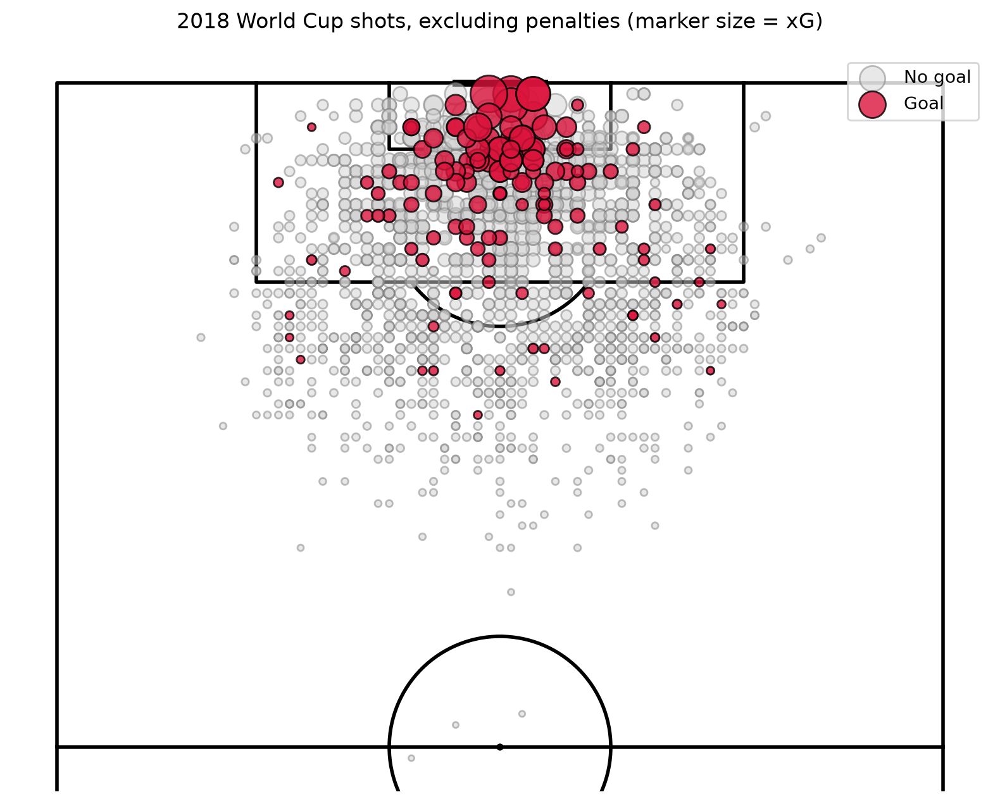

# xG Model: 2018 FIFA World Cup

A simple expected-goals (xG) model built from StatsBomb open data using SQL (DuckDB) and logistic regression. It estimates how likely a shot is to become a goal and compares the result with StatsBomb's own xG.



*Marker size shows predicted xG. Penalties and shootout kicks are excluded.*

## Results

**Data:** 64 matches, 1,638 shots, 135 goals (29 penalties and 39 shootout kicks excluded).

**Final model:** logistic regression with three features: distance to goal centre, shot angle and a header flag. Predictions come from 5-fold cross-validation grouped by match, repeated with 5 different seeds and averaged, so no shot is predicted by a model that saw its own match.

| | AUC | Log loss |
|---|---|---|
| Constant probability (baseline) | 0.500 | 0.2846 |
| Final model (3 features) | 0.748 | 0.2506 |
| StatsBomb xG | 0.782 | 0.2373 |

- The model clearly beats the baseline, but StatsBomb's xG ranks shots better. I did not test why. StatsBomb likely uses more inputs and more training data, but adding freeze frame features to my model did not close the gap.
- **Odds ratios:** each extra yard of distance lowers the odds of a goal by about 8% (0.922), each extra degree of angle raises them by about 2.4% (1.024), and a header has about 57% lower odds than a foot shot from the same position (0.432).
- Headers have the highest raw goal rate (10.3%), but they are taken much closer to goal. Once distance and angle are controlled for, headers are harder shots.
- **Calibration** is good in four of five xG groups. In the third group the model predicts 5.7% while 3.4% were scored (328 shots), which may be chance.
- The model's total xG (135.0) equals the actual number of goals (135), but this is expected for a logistic regression fitted on the same tournament. StatsBomb's xG sums to 150.0 for the same shots; I did not investigate why.

## Feature experiments

All comparisons use 5x repeated cross-validation grouped by match. The ± values only reflect random fold splits, not the uncertainty that comes from having just 135 goals.

| Feature set | AUC | Log loss |
|---|---|---|
| Distance, angle, header (final model) | 0.748 ± 0.004 | 0.2508 |
| + defenders in the shot triangle | 0.748 ± 0.004 | 0.2504 |
| + goalkeeper distance | 0.738 ± 0.005 | 0.2536 |
| + both | 0.739 ± 0.005 | 0.2530 |
| Extended (+ pressure, first-time shot, play pattern, technique), no freeze frame | 0.759 ± 0.003 | 0.2483 |

- Adding pressure, first-time shot, play pattern and technique gave a small but consistent improvement (about +1.1 AUC points).
- Freeze frame features (defenders in the triangle between ball and posts, goalkeeper distance) did not help on top of the three-feature model, and goalkeeper distance lowered AUC. With only 135 goals, extra features may mostly add noise (a hypothesis I did not test).
- I kept the three-feature model as the final model because its odds ratios are easy to interpret. The extended model is slightly better.

## Exploration (SQL)

- Goal rate falls with distance from 37.7% (0-6 yards, 53 shots) to 2.8% (25+ yards, 469 shots).
- Goal rate rises with shot angle from 3.5% (10-20°) to 23.6% (40°+).

## Limitations

- One tournament and 135 goals. Differences of one or two AUC points should be read with caution.
- The final model uses only shot location and a header flag.
- The results are not tested on other competitions.

## Run it yourself

```
python -m venv .venv
.venv\Scripts\activate          # Windows
source .venv/bin/activate       # macOS / Linux
pip install -r requirements.txt
```

Open the notebook and run all cells. The first run downloads the match events (a few minutes) and caches them in `events.pkl`.

## Data

Data: [StatsBomb Open Data](https://github.com/statsbomb/open-data), accessed with `statsbombpy`. Used under the [StatsBomb Public Data User Agreement](https://github.com/statsbomb/open-data/blob/master/LICENSE.pdf).


The raw data is not included in this repository. This analysis is my own work and does not represent the views of StatsBomb.